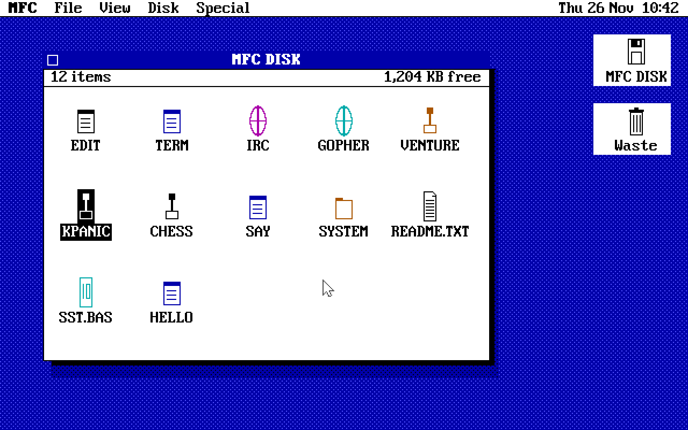
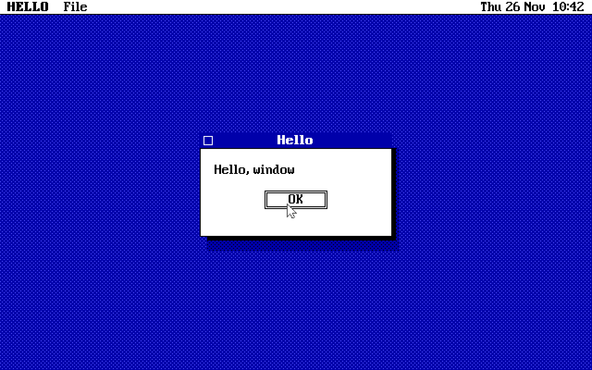

# An optional graphical OS for MFC: design

Research spike, written from [briefs/gui-os-research.md](briefs/gui-os-research.md). Part 1
decides how the GUI is launched and left, which display model it draws on, and how it gets a
pointer (questions 1 and 2). Part 2 follows it and covers questions 3 to 7: what to take from
GEOS, the kernel ABI, filesystem integration, the application model and phasing. Nothing here
is implemented, and no prototype was built.

The reference is [mist64/geos](https://github.com/mist64/geos), the reconstructed source of
GEOS 2.0. Nothing from it is adapted yet, so there is no credit or `vendor/geos/` change in
this spike; part 2 records the plan for later.

Conventions. Any figure that is not measured is marked **estimate** and shows its
arithmetic. Any address, register or entry point that does not exist today is marked
**proposed**. Everything unmarked is in [architecture.md](architecture.md),
[board.md](board.md) or [video_design.md](video_design.md).

Mockups. [images/gui/](images/gui/README.md) holds static pictures of the GUI drawn under this
design's display rules: the desktop, a menu, a dialog and the question 6 hello window. It also
shows the failure modes the PR #8 review found. They are illustrations; no GUI code exists.

## Summary of decisions

| Question | Decision | Rejected |
|---|---|---|
| Launch | A DOS command `DESK`, a 21-byte stub program on disk that restores the pager, maps bank 2 and jumps to the GUI. The GUI quits through `K_RETURN_MODULE`, which lands at the `]` prompt. `DESK` as the last line of `SYSTEM/STARTUP.CFG` starts it at boot, ending the config there | A `MODULE_DIR` record (a kernel ROM change for no gain); a GUI that lives entirely in user RAM |
| Placement | Code in module bank 2. State in the `$0400-$07FF` scratch page. Overflow and resources on disk | All-RAM `.PRG`; state in bank 0 (not visible while bank 2 is mapped) |
| Display | Glyph-tiled framebuffer: 640x400, 1 bit a pixel, two colours per 8x16 cell, built from nine font sets switched by raster band. Every colour boundary lies on the 8x16 cell grid | Character-cell GUI; new VIC bitmap mode (kept as a drop-in upgrade) |
| Pointer | A chipset mouse device (7 registers, **proposed** `$FED5-$FEDB`), drawn as sprite 16 | Keyboard-only pointer on `$FE0F` (kept as a fallback source) |
| GEOS (part 2) | Adopt its table-driven menus and dialogs, graphics string, process table and flag-and-vector events; five parts adapted, the rest rewritten; drop its bitmap addressing, desk accessories and clock | Copying GEOS's C64 layout; its deskTop (no source in mist64/geos) |
| Kernel ABI (part 2) | Six new entries, an NMI change and a RESET line, 544 B of 1,209 B free | An event queue in the kernel; pixel primitives in the kernel |
| Filesystem (part 2) | Two-pass directory read; the desktop loads programs itself; a plain `.PRG` may overwrite `$0400-$07FF`, so the desktop rebuilds on return | Keeping desktop state alive across a launch |
| Applications (part 2) | A `.PRG` with a 96-byte GUI header, linked against `libmfcgui` | A header alone; a library alone; a ROM module |

## "Optional": launch and exit

### What "optional" means here

The machine boots exactly as it does today: RESET, the boot report, the DOS, the
`SYSTEM/STARTUP.CFG` runner, the sign-on, the `]` prompt. No kernel or DOS routine changes to
make the GUI exist. The GUI is a program the shell launches, as `WIN` was under MS-DOS.

### The command

The command is **`DESK`** (the desktop). It is short like `MON` and `EDIT`, it names the thing
rather than a vendor's product, and it leaves room for later `DESK` arguments. Typing it at
the `]` prompt starts the GUI. Quitting from the desktop's menu returns to the `]` prompt.

### How it is built: a stub and a module

`DESK` is a disk file, `DESK.PRG`, of 21 bytes, loaded by the DOS like any program (2-byte
load-address header, entry at the start; see `dos_internals.md`, "Program file format").

What the loader does decides the rest. `_DOS_RUN_FILE` (`dos.asm`) loads the body, resets the
stack (`LDX #$FF / TXS`), pushes `DOS_WARM-1` and jumps to the load address. Its header says it
"does NOT return on success": a program's `RTS` lands on `DOS_WARM`, at the `]` prompt, never
back in whatever called the loader. The stub is written for that:

```
        LDA #1
        STA PAGE_ENABLE     ; $1E: pager on, as RESET leaves it (a boot launch left it off)
        LDA #2
        STA MODULE_BANK     ; map bank 2 into $B000-$EFFF
        LDA $B000
        BNE @go             ; an unpopulated bank reads $00, as BANK_LAUNCH checks
        STZ MODULE_BANK     ; no GUI ROM: bank 0 again, and
        RTS                 ;   RTS lands on DOS_WARM, the ] prompt
@go:    JMP $B000           ; the GUI's entry; it never comes back here
```

That is 2 + 2 + 2 + 3 + 3 + 2 + 3 + 1 + 3 = 21 bytes. The stub is entered once and is never
returned to, so where it loads does not matter; it loads at `$0800` like every program, and a
program the desktop later loads over it breaks nothing. `PAGE_ENABLE` and `MODULE_BANK` have no
`mfc.inc` equates; the stub source names them itself (`kernel_vars.inc`).

The GUI proper is a 16 KB ROM module installed as bank 2. It is built and installed the way
the monitor is (`monitor.rom` into bank 4): a new `gui.rom`, and one more `installBank` line
in the host (**proposed**; the host change is `src/computer/Computer6502.cpp`, done in the
implementation work). Bank 2 is free in `architecture.md`, and it is the one that was the
assembler before the assembler folded into the monitor.

The GUI leaves through **`K_RETURN_MODULE` (`$FF12`)**, the exit BASIC and FORTH use. It is in
the kernel ROM, so the GUI can `JMP` to it from bank 2: `RETURN_FROM_MODULE` (`kernel.asm`)
unmaps the bank (`STZ MODULE_BANK`, safe because it is running from `$F000-$FFFF`), resets the
stack, calls `CLEAR_SCREEN` and jumps to `DOS_WARM`. A disk program and a module therefore exit
the same way, with a clean stack, through `DOS_WARM`.

Why a stub on disk rather than a record in `MODULE_DIR` like BASIC, FORTH and the monitor. The
exit is the same either way, so the reasons are cost and ownership:

- A `MODULE_DIR` record is 5 bytes of kernel ROM plus the name string (`"DESK", 0`, 5 more),
  and a kernel version bump, for a launch the stub already gives. The stub costs no kernel ROM.
- The DOS resolves a name as built-in command, then `MODULE_DIR` module, then disk file, so the
  stub is found without any table change.
- The stub is the only part that must be on disk, and it is replaceable like any program. The
  code that is large is in ROM.

`DESK` therefore appears in `CATALOG` and can be copied or replaced like any program. `&DESK`
is not needed. `BANKS` lists only `MODULE_DIR`, so it will not show bank 2. The boot report
reads identity blocks from banks 1 to 255, so a `ROM_ID` block in `gui.rom` adds one line,
"GUI ROM installed as module bank 2", to the report. That is the same line every other bank
prints, and no boot step changes.

### Quitting and "DOS state intact"

Quitting runs, in order:

1. `K_RASTER_IRQ` (`$FF45`) with 0, so no raster handler is left calling into a bank that is
   about to go, and no band switch can land in the middle of the steps that follow.
2. `kCmdFontReset` (`$0A`) through `VREG_CMD`. It reloads CP437 into every font set, because
   the display model below overwrites nine of them and a later program that selects a soft
   font set must not find pixels in it. It takes no parameter.
3. `STZ GUI_RETURN` (**proposed**, `$02F4`, question 5; 3 bytes of module). `K_RETURN_MODULE`
   ends in `DOS_WARM`, which is exactly where the proposed return hook tests that flag. A flag left
   set by an earlier launch would make Quit relaunch `DESK`, and the user could not reach `]`
   without STOP. Clearing it here makes Quit always land at `]`.
4. `JMP K_RETURN_MODULE`. Its clear is `CLEAR_SCREEN`, the routine behind `K_CLEAR_SCREEN`
   (`$FF0C`, `kernel.asm`): it loads the default attribute (`$02`) into `VREG_ATTR` and a space
   into `VREG_CMD_PARAM`, issues the clear, and homes `CURSOR_X` and `CURSOR_Y`. The clear also
   selects the ROM font and set 0, turns every sprite off, resets the scroll region, row sizes
   and fine scroll, and turns the raster interrupt off (`VIC::cmdClear`). A raw `kCmdClear`
   written by the GUI would not do: it fills with whatever `VREG_CMD_PARAM` and the attribute
   latch hold, which are the band handler's last font-set number and whatever colour the GUI
   last drew in, and it leaves the kernel cursor where it was
([what that looks like](images/gui/8-quit-raw-clear.png)).

`DOS_WARM` then prints one newline and the prompt on the cleared screen, and puts the theme and
the default attribute back, as it does after any program.

DOS state is intact because the GUI never writes where the DOS keeps it. The DOS's variables
are in page 3 and up (`$0300` onward) and in the DOS ROM's own workspace; the current drawer
(`OPEN`) is one of them. The GUI's state is in `$0400-$07FF` (below), its code is in
bank 2, and it prints nothing through `K_PRINT_CHAR`, so the pager and cursor are untouched.
The stack does not need to balance: `_DOS_RUN_FILE` reset it on the way in and
`K_RETURN_MODULE` resets it on the way out.

### Starting it at boot

Add one line to `SYSTEM/STARTUP.CFG`, as the last line:

```
# SYSTEM/STARTUP.CFG
OPEN GAMES
DESK
```

`_DOS_STARTUP` runs each line through the shell's own interpreter (`_DOS_DISPATCH`), so `DESK`
launches the stub like a typed command. That launch does not come back to the runner, because
no launch does: `_DOS_RUN_FILE` and `K_LAUNCH_BY_NAME` both leave the call chain behind, a
`MODULE_DIR` module and a disk program alike. What follows, from `dos.asm` as it stands:

- **Lines after `DESK` never run**, not even after the user quits. `DESK` must be the last line.
- **The runner's restore is skipped.** `_DOS_STARTUP` saves `PAGE_ENABLE` in `DOS_CFG_PAGE`,
  turns paging off for the file, and restores it only at its `@done`, which a launch never
  reaches. The stub sets `PAGE_ENABLE` to 1 itself. That is the value RESET gives it, and no
  verb changes it today; if a pager setting is ever added, the stub must read that setting
  instead.
- **The sign-on is skipped.** `_DOS_COLD` calls `_DOS_SPLASH` after `_DOS_STARTUP` returns,
  which it now does not. Quitting the GUI after a boot launch lands at the `]` prompt on a
  cleared screen, in the drawer the config opened, with no sign-on box. The box is not in the
  ABI, so the GUI cannot print it; that is accepted.

After a typed `DESK` nothing is skipped: quitting lands at `]` as quitting any program does.
No DOS routine changes for either path.

The existing escape hatch covers a broken desktop: ESC pressed during boot skips the file, and
the STOP key (NMI) breaks into the monitor. DOS itself never starts the GUI; with no `DESK`
line, nothing changes.

### Placement: bank 2 confirmed, with a caveat about state

Bank 2 fits and is the right home, with two facts to design around.

**Banks 1 to 255 are ROM, and bank 0 is the only RAM.** `Memory` ignores writes to a mapped
non-zero bank. So the GUI cannot keep variables in the window, and it cannot use bank 0 as
scratch, because bank 0 is not visible while bank 2 is mapped. The module is code and
constants only. Writable state goes in user RAM, which is always visible.

The state goes in **`$0400-$07FF`**. `architecture.md` calls it scratch for any program
that uses neither the monitor's `T:`/`Z:` snapshot nor the assembler. The GUI uses neither.
That is 1 KB, all of it the GUI's: the stub is never returned to, so it needs no room
there. It holds the pointer, the event queue, menu and window records and the dirty-rectangle list. A zero-page budget of about 32 bytes was assumed to fit the gap at
`$3A-$5A` that `architecture.md` lists. **Part 2 corrects this**: the DOS uses `$3A-$3F`, so
the free gap is `$45-$5A`, 22 bytes (see "Part 2 conventions and sources").

Two consequences. A **STOP** key press maps the monitor over the window, and `Q` returns to
the DOS prompt, not the desktop: the GUI is dropped, and that is acceptable for a debugger
break. The monitor's break entry does not clear the screen, so without a change it would print
into the GUI's cell plane, drawn from a pixel font set, with sprite 16 and the raster bands
still live ([what that looks like](images/gui/7-stop-monitor.png)). The NMI handler therefore gains (**proposed**, a few bytes in the kernel; question
4) a call that disables the raster interrupt, because that handler is in the window the NMI
path unmaps, and a `JSR CLEAR_SCREEN`, which puts back the ROM font, set 0, the default
colours and a homed cursor and turns the sprites off. And a plain `.PRG` that the desktop launches loads at `$0800`
and may use `$0400-$07FF` as scratch, so the desktop rebuilds its state from the DOS and the
disk when such a program returns. Only GUI-aware applications (question 6) promise to leave
that page alone.

**16 KB is the budget.** Event loop, menus, dialogs, graphics primitives and one text
renderer are the core of such a toolkit. I expect them in 10 to 14 KB of 65C02 code
(**estimate**, from the size class of comparable 8-bit toolkits; not measured, and part 2
gives per-part sizes). The remainder, 2 to 6 KB, is little for icons and fonts, so those
live on disk and load into user RAM or video RAM at start. If the code alone exceeds 16 KB,
a second ROM bank (any bank above 4 is unused; **proposed** bank 5) holds the desktop and
file manager, reached through a trampoline in the `$0400-$07FF` page. That is a
page-sized change, not a redesign.

### Alternatives considered

| Option | Result |
|---|---|
| **`.PRG` in user RAM** | Rejected as the home of the code. A 10 to 14 KB resident GUI leaves 18 to 22 KB of the 32 KB at `$0800-$87FF` for applications (**estimate**: 32 KB less the code), and every application loads at `$0800`, so the GUI would have to sit high and crowd the C stack at the top of user RAM. Launching an application would overwrite or evict it. It also needs the disk and a full load to start. It is simpler to build, which is its only advantage. |
| **Module only, via `MODULE_DIR`** | Rejected, narrowly. It launches and exits exactly as the stub does (both end at `DOS_WARM`, and both end a `STARTUP.CFG` run where they stand), so it is not wrong; it spends about 10 bytes of kernel ROM and a kernel release on a launch the 21-byte stub gives for nothing. |
| **Mix: ROM code, RAM state, disk resources** (recommended) | The code costs no user RAM, the stub makes launch an ordinary DOS program launch, and the only kernel changes are the NMI and RESET lines of question 4. |

## Question 1: Display model

### The constraints

The VIC is a text chip. The cell planes and the 16 font sets live inside it and are reached
through the register port at `$FE2D-$FE37` and `$FE62-$FE64`, so the guest pays one port write
per byte and pays no address space (`video_design.md`, "Architecture"). A cell is 8x16
nominal pixels, and the screen is 80x25 cells, which is 640x400 nominal pixels. The host
scales that, so a pixel is the same size in both directions.

All redraw times below use these assumptions, and each is **estimate**:

- The clock is 4 MHz and the frame is 60 Hz, so one frame is 4,000,000 / 60 = 66,667 cycles.
- A port access costs the same as a RAM access. `board.md` says there is no bus contention and
  the host models no device delay.
- A copy loop from RAM to a port is `LDA (zp),Y` (5) + `STA port` (4) + `INY` (2) + `BNE` (3) =
  **14 cycles a byte**. A fill with one value, unrolled as repeated `STA port`, is **4 cycles
  a byte**.

Nothing was measured. The cycle counts are exact for a loop of that shape, and the first
implementation slice (part 2) should time a full region redraw on the emulated machine to confirm
the port costs the same as RAM.

### The three options

**A. Glyph-tiled framebuffer.** Every cell of a region gets its own glyph code, and drawing
means writing that glyph's 16 bytes in font RAM through `VREG_FONT_DATA`. One 256-glyph font
is 4,096 bytes and covers 16x16 cells = 128x256 pixels. There are 16 sets, and `kCmdFontSet`
can change the live set mid-frame as a raster split (`video_design.md`, "The raster": the
font is one of the things that splits). A cell row is 16 pixel lines, so a split at a
multiple of 16 lines changes the font for a whole row. With 80 cells in a row, a band of 3
rows holds 240 distinct glyphs, which fits one set. Nine bands (8 of 3 rows, 1 of 1 row)
cover all 25 rows, so the **whole screen is a 640x400 bitmap using nine font sets**.

Colour comes from the cell's attribute byte: a 3-bit foreground (plus bright) and a 3-bit
background per 8x16 cell, which is two colours in each cell, set through `VREG_COLOR` or the
`VREG_ATTR` latch. Pixels within a cell cannot differ in colour, like the ZX Spectrum's
attribute clash but on a coarser 8x16 grid.

**B. Character-cell GUI.** Windows, menus and dialogs from CP437 box-drawing characters and
the soft font. There are no pixel graphics. A cell is the smallest thing that can be
addressed: 80x25 positions. Each cell takes any of the 256 glyphs in the live set and its own
colours. Sprites supply the pointer and icons.

**C. A new VIC bitmap mode** (**proposed**). A chip-side mode bit makes the renderer draw a
linear bitmap instead of glyphs. The baseline is 640x400 at 1 bit a pixel in 32,000 bytes of
chip RAM, with colour from the existing attribute plane per cell. A 4-bit variant at 320x200
(16 colours a pixel) uses the same 32,000 bytes and the same time through the port.

### Comparison

| | A. Glyph-tiled | B. Character-cell | C. New bitmap mode |
|---|---|---|---|
| Resolution | 640x400 using nine bands of font sets (128x256 with a single set) | 80x25 cells; the pixel grid is not addressable | 640x400 (or 320x200 at 4 bpp) |
| Colours | 2 per 8x16 cell (3-bit fg + bright, 3-bit bg) | 2 per cell | 2 per cell at 1 bpp; 16 per pixel at 4 bpp |
| Memory in the 64K map | 0 | 0 | 0 |
| Memory in the chip | 9 x 4,096 = 36,864 B of the 65,536 B font RAM; 7 sets stay free | 4,000 B (cell plane and colour plane, already there) | 32,000 B of new chip RAM |
| Full-screen redraw | 32,000 B x 14 = 448,000 cycles = 112 ms = 6.7 frames (copy); 32,000 x 4 = 128,000 = 32 ms = 1.9 frames (solid fill) | 2,000 cells x 14 = 28,000 cycles = 7.0 ms = 0.42 frame; 2,000 x 23 = 46,000 cycles = 11.5 ms = 0.69 frame if every cell also takes its own attribute | Same bytes, same time as A: 112 ms copy, 32 ms fill. Less with a chip-side fill or blit, which is extra cost |
| One 4 KB region (a 128x256 window) | 4,096 x 14 = 57,344 cycles = 14.3 ms = 0.86 frame | 16x16 cells = 256 x 14 = 3,584 cycles = 0.9 ms | Same as A |
| Text, byte-aligned (monospace) | 16 bytes a glyph x 14 = 224 cycles = 56 us; an 80-char line is 4.5 ms | 14 cycles a character; an 80-char line is 1,120 cycles = 0.28 ms | As A |
| Text, proportional | About 100 cycles a pixel row (two read-modify-writes at about 38 cycles, below, plus about 24 to shift and mask) x 16 rows = 1,600 cycles = 0.4 ms a character; a 40-char line is 16 ms, about one frame | Not possible | As A |
| Icons, lines, patterns | Yes, pixel-exact | Only as 2x2 glyph tiles or sprites | Yes, pixel-exact |
| Chip work (C++) | None | None | New registers, renderer, tests (below) |
| Pointer sprite | Composited above the planes, no save-under | Same | Same, if the renderer keeps sprites on top |

The 56 us figure is 224 / 4,000,000. The 11.5 ms figure for B with attributes is one pass:
`VREG_CHAR` takes the colour from the latch, so each cell writes `VREG_ATTR` and then
`VREG_CHAR` (`LDA (zp),Y` 5 + `STA` 4 + `LDA (zp),Y` 5 + `STA` 4 + `INY` 2 + `BNE` 3 = 23
cycles a cell). No second stream through `VREG_COLOR` is needed.
Because all of these are loop-shape arithmetic, they are lower bounds: a real drawing routine
adds address setup, clipping and the branches around the loop. A typical dialog (320x160
pixels, 6,400 bytes) is 6,400 x 14 = 89,600 cycles = 22 ms = 1.3 frames, and a menu
(160x112, 2,240 bytes) is 31,360 cycles = 7.8 ms.

### What each option costs

**A costs no chip work and pays in CPU and in discipline.** The nine-band split uses
machinery that exists and has tests (`tests/test_vic_raster.cpp`, and the font set switching
in `tests/test_vic_softfont.cpp`), driven by `K_RASTER_IRQ` (`$FF45`). A band change is one
IRQ per band. Each costs about 91 cycles, counted from `IRQ_HANDLER` and `RASTER_DISPATCH` in
`kernel.asm`: 7 to enter; 21 in the kernel's check and register save (`PHA`, `LDA`/`BPL` on
`VREG_RASTER_CTL`, the acknowledge, `PHX`, `PHY`); 6 for the `JSR RASTER_DISPATCH`; 6 for its
`JMP (RASTER_VEC)`; 20 in the handler to set the next compare line and the next set; 6 for
`RTS`; 25 to restore, test the timer and `RTI` (`PLY`, `PLX`, `LDA`/`BPL` on `TIMER_IRQ_ACK`,
`PLA`, `RTI`). Nine of them are 819 cycles a frame, which is 1.2% of 66,667 (**estimate**).
The rules the raster section imposes become GUI rules. The GUI never
writes `$FECD` to present, because a presenting program is drawn from its live settings and
its bands are ignored; the cost is that a frame is shown at the next boundary, at most one
frame (16.7 ms) after it is finished. The hardware cursor is hidden through
`VREG_CURSOR_HI`. A drawing routine addresses a pixel as (set, glyph, row), not (x, y),
and that mapping lives in one routine so the rest of the GUI sees a 640x400 plane.
The mapping is also what makes C a cheap upgrade later. Setting up the cell plane (glyph
codes and colours for 2,000 cells) is done once at start: 2,000 x 14 = 28,000 cycles = 7 ms.

*Raster jitter and the timing margin.* A split takes effect on the line where the
`kCmdFontSet` write lands (`VIC::recordSplit`), not on the compare line. A line is 66,667 / 500
= 133 cycles. From the start of the compare line the write lands after: up to 7 cycles to finish
the current instruction, 7 to enter, 21 of check and save, 12 for `JSR` and `JMP (RASTER_VEC)`,
and 12 in the handler (`LDA #` / `STA VREG_CMD_PARAM` / `LDA #` / `STA VREG_CMD`), about 59
cycles. That leaves a margin of about 74 cycles inside the first line of the band
(**estimate**). Two things eat it:

- **The jiffy IRQ.** It shares the IRQ line. If the compare arrives while the timer half of
  `IRQ_HANDLER` is running (about 65 cycles with no beep or chime playing, more with one), the
  raster waits for its `RTI` and the switch can land a line late.
- **Any `SEI` section**, in the kernel or the GUI, delays it by its own length.

A late switch draws the top pixel line (or lines) of the band's first cell row from the
previous band's set: one line of wrong pixels across the screen for one frame
([what that looks like](images/gui/6-raster-jitter.png), with several bands late at once). The GUI rules are
that the band handler sets the font first and the next compare line after, that GUI code holds
`SEI` for no more than about 20 cycles at a time, and that nothing else in the GUI runs from the
IRQ. Slice 0 measures how often a switch is late. If the glitch is visible it counts against A
the way a slow redraw does: C needs no raster bands, so it removes the problem outright.

*The shared command parameter.* `kCmdFontSet` takes its set from `VREG_CMD_PARAM` (`$FE36`),
which every parameterised command shares and which cannot be read back. A raster IRQ that lands
between main-line code's `STA VREG_CMD_PARAM` and its `STA VREG_CMD` overwrites the parameter,
and the main-line command runs with the band's set number. The convention: while the bands run,
main-line code issues a parameterised command only inside `PHP` / `SEI` ... `PLP` (4 bytes and 9
cycles a command, well inside the 20-cycle limit above), and the band handler touches no other
shared VIC state (not the font index, the cell index or the attribute latch).

Drawing is read-modify-write through the port, since there is no 32,000-byte copy of the
screen in RAM to compose in (user RAM is 32 KB in total). The font port has one
auto-incrementing index (`VREG_FONT_LO/HI`), and reading `VREG_FONT_DATA` advances it as
writing does, so changing a byte in place costs a seek, a read, the merge, a second seek and
the write: about 38 cycles a byte (**estimate**: 14 + 4 + 6 + 14 + 4, a seek being two `LDA zp`
/ `STA abs` pairs). A compositing buffer is a region buffer the size of the window being drawn,
in tile order, in user RAM. That is the real memory cost of A and of C, and it is the same for
both.

**B costs nothing and gives up the point of the exercise.** It is the cheapest and fastest
option, and it is what the MFC shell already is. But it has no proportional fonts, no icons
that are not tiles, no lines at an angle, and no dialogs that are anything but a grid of
80x25. The brief names proportional fonts, menus and a file manager with icons as the
target. B delivers menus and dialogs, and it does not deliver the rest, so it is a text-mode
user interface (Turbo Vision, the DOS Shell) rather than a GEOS. It is the right fallback
if A fails its first measurement.

**C costs a chipset change, and A already gives the same picture.** The cost, concretely
(**estimates**):

- *VIC registers.* A mode/control register, a bitmap byte index (low and high, since 32,000
  needs 15 bits) and an auto-incrementing data port, which is **4 bytes**. A clear-bitmap
  command goes through `VREG_CMD` at no register cost. A chip-side fill or blit (which is what
  would make C faster than A) is 8 to 10 more bytes for source, destination, size and a go.
- *I/O budget.* `$FED5-$FEFF` is 43 bytes. The minimum C takes 4 of them, leaving 39. With a
  blitter it takes about 14, leaving about 29. The mouse (below) takes 7 of the same 43 whichever
  option is chosen, so C with a blitter and a mouse leaves about 22.
- *Renderer.* `DisplayWidget` draws the bitmap with per-cell colours in place of glyphs when
  the mode bit is set, and has to agree with the raster-band logic (a band may carry the mode
  or not) and with sprites, which composite on top. About 150 to 250 lines of C++ in
  `VIC.h`, `VIC.cpp` and `DisplayWidget.cpp`. `video_design.md` notes that "renderer geometry
  is not unit-testable here and is verified by eye", so the renderer is the part with no automated
  test.
- *Tests.* A new `tests/test_vic_bitmap.cpp` in the style of `test_vic_softfont.cpp`: the
  addresses pinned, the index auto-incrementing and wrapping at 32,000, the data
  round trip, the mode switching off to text, `kCmdClear` turning it off, and the sprites
  and font untouched. About 100 to 150 lines. Plus `board.md` and `architecture.md` tables and the
  memory-layout validator.

What C buys over A is **linear addressing** (a horizontal line is contiguous bytes, not a
stride of 16), no raster IRQ and so no raster jitter, and all 16 font sets left free, since
the bitmap uses none of them, where A holds nine and leaves 7. Redraw speed is the same unless the blitter is built. Those gains do not
justify a chip change before anything has been drawn.

### Recommendation

**Build the GUI on the glyph-tiled framebuffer (A): a 640x400, 1-bit plane with two colours
per 8x16 cell, held in nine font sets switched by raster band.** It gives the pixels the brief
wants (lines, icons, proportional text) from hardware that exists and is tested, at no I/O
budget and no C++ change. Every drawing routine goes through one "(x, y) to (set, glyph, row)"
mapping, so if the first measurement shows the strided addressing or the raster bands to be a
real problem, C replaces that one routine and the rest of the GUI does not change.

Rejected: **B** because it is a text UI and cannot show proportional type or icons, which is
the goal; it remains the fallback. **C** because it spends the last scarce resource, I/O page
bytes and a renderer, to get the picture A already produces, and it can be added later behind
the same mapping routine if the measurement asks for it.



More mockups, and how they were drawn, are in [images/gui/](images/gui/README.md).

### The cell-grid rule

Colour belongs to the 8x16 cell, not the pixel, so **every colour boundary lies on the cell
grid**. A rectangle that has colours of its own (a window, its title bar, a menu, a menu item's
highlight, a dialog, a button, a list row, an icon) starts at an x that is a multiple of 8 and a
y that is a multiple of 16, and its width is a multiple of 8 and its height a multiple of 16.
Off the grid, the edge cells hold two areas' pixels with one cell's two colours, so the
desktop's colours bleed into the window's edge, or the reverse.

What follows from it:

- Menu items and list rows are **16 pixels tall**, one cell row, so a highlight (the cell's
  colours swapped) covers exactly one item.
- A title bar is one cell row. A button is a whole number of cells, 8x1 (64x16) by default.
- The toolkit enforces the rule rather than trusting callers: `GUI_CENTRE` centres on whole
  cells, and a rectangle given in pixels is rounded outward to the grid before it is drawn.
- Pixels inside the cells are free. Text, lines, frames and icon art drawn in the colours of
  the rectangle they sit in may be at any pixel position; only a change of colour must wait
  for a cell boundary.
- The pointer (sprite 16) and dragged outlines are sprites, composited over the plane, so the
  rule does not apply to them.

Option C keeps the rule at 1 bit a pixel (its colour is still per cell). The 4-bit variant
would lift it.

What breaking the rule looks like: [a window off the grid](images/gui/5b-cells-unaligned-clash.png)
(against [the same window on it](images/gui/5a-cells-aligned.png)), and
[a menu highlight across two items](images/gui/9b-highlight-straddle-zoom.png).

## Question 2: Pointer and input

### What exists

A keyboard reaches the guest two ways. `PIA_DATA` is a queue of typed bytes; the arrow keys
arrive as ESC-prefixed sequences (`ESC [ A` to `ESC [ D`), and there is no key-up. `KEY_STATE`
at `$FE0F` is the live held-key bitmask: bit 0 Up, 1 Down, 2 Left, 3 Right, 4 Fire (Space),
5 Button 2 (Left Shift), updated by the host on every press and release. It reads 0 in the
console build and the headless test harness. The host already has mouse handlers in
`DisplayWidget` (`mousePressEvent`, `mouseMoveEvent`, `mouseReleaseEvent`), used only to select
text for copying. There is no mouse device.

The sprite block has 17 sprites at `$FE65-$FECA`, positioned in nominal pixels 0 to 639 by 0
to 399, with bitmap patterns (16x16, 4 bits a pixel, palette slots 1 to 15, slot 0
transparent) from the pattern RAM at `$FECE-$FED0`. The renderer draws them in index order
over the planes (`DisplayWidget::drawSprites` loops 0 to 16), so **sprite 16 is topmost**.
Neither the scroll region, the fine scroll nor the raster bands move them.

### The pointer is a sprite

Whichever device supplies the position, the pointer is a bitmap sprite, sprite 16
(**proposed** convention). Reasons:

- It composites over the glyph-tiled plane, so it needs no save-under, no restore and no
  redraw when it moves. In GEOS the pointer was a hardware sprite as well, for the same reason.
- One 16x16 arrow costs one pattern slot, which is 128 bytes: 128 x 14 = 1,792 cycles to
  upload once (**estimate**), which is under 3% of a frame.
- Moving it is writes to the position bytes only. Offset 1 and offset 3 also carry size,
  magnify and enable bits, which the GUI holds constant: four stores of
  about 4 cycles plus the operand setup, around 30 cycles in all (**estimate**), so every
  frame is affordable.
- A second pattern slot per cursor shape (arrow, text beam, busy) is switched by changing the
  one glyph register, as `video_design.md` describes for animation.
- The sprite's pixel grid is the framebuffer's: 640x400. The pointer's hot spot maps to a
  framebuffer pixel with no scaling.

The cost is that the pointer is not part of the plane, so a screen capture of the plane does not
include it, and the GUI has 16 of the 17 sprites left for other overlays (drag outlines,
icons being dragged).

### Option 1: keyboard pointer

Poll `$FE0F` once per frame with `K_WAIT_FRAME` (`$FF42`). The four direction bits give eight
directions. Fire (Space) is button 1 and Left Shift is button 2.

The speed cannot be analogue, so the pointer needs an acceleration ramp: 1 pixel a frame for the
first few frames, rising to 8. Crossing the screen at the top speed is 640 / 8 = 80 frames =
1.3 s, and at the start it is 640 frames = 10.7 s. A pixel-accurate pick of a small target
means releasing and re-pressing to reset the ramp. It costs no chipset work and has no
host-side code.

Problems:

- **Two buttons only**, and both are keys the typist also uses: Space inserts a space in a text
  field, and Shift is a modifier. The GUI would need a mode to say whether Space is a click or
  a character.
- **ESC is not an action.** The arrow sequences in the queue begin with a bare ESC, and held-key
  buffer drops can leave a lone ESC. A GUI that treats a lone ESC as "cancel" would
  mis-cancel. (The same rule is already followed by the full-screen programs.)
- **No drag with a modifier**, because Space and Shift are the only buttons.
- **Not testable by the existing suites without a host path**: the register reads 0 in the
  console build and the headless harness. Only a test that calls `PIA::setKeyState` can drive
  it, and then it does not exercise the host mapping.

### Option 2: a chipset mouse device

A new device, `Mouse`, a chip in the board's own style. The host reports the pointer's
**absolute** position in nominal pixels, so no relative deltas, no acceleration and no pointer
grab are needed: the sprite sits where the host's pointer is.

**Registers** (**proposed**, `$FED5-$FEDB`, 7 bytes of the 43 free):

| Address | Name | Contents |
|---|---|---|
| `$FED5` | `MOUSE_X_LO` | X, bits 7-0 (0 to 639). Reading it latches `MOUSE_X_HI` and `MOUSE_Y` so the three read as a pair |
| `$FED6` | `MOUSE_X_HI` | X bit 8 and bit 9, from the latch |
| `$FED7` | `MOUSE_Y_LO` | Y, bits 7-0 (0 to 399), from the latch |
| `$FED8` | `MOUSE_Y_HI` | Y bit 8, from the latch |
| `$FED9` | `MOUSE_BTN` | Bit 0 left, bit 1 right, bit 2 middle, held right now |
| `$FEDA` | `MOUSE_WHEEL` | A wrapping counter of wheel steps, not cleared by reading (the frame counter's rule) |
| `$FEDB` | `MOUSE_CTL` | Bit 0: capture. Set by the guest to say the guest owns the mouse |

The low-byte-latches-the-rest read follows the RTC and the raster; the counter that is not
cleared by reading follows `$FECD`. Cost is 7 of 43 bytes, leaving 36.

**Host side.** `DisplayWidget` already sees mouse events. It would call
`setMouseTracking(true)`, convert each event's position by the current zoom into nominal
pixels (the widget knows its character size and zoom, and `board.md` fixes the 640x400 grid),
clamp to 0..639 and 0..399, and hand it to the device, as `DisplayWidget::updateKeyState`
hands `PIA::setKeyState` the held keys. While `MOUSE_CTL` capture is set the widget stops
using left-drag for text selection and hides the host cursor (`Qt::BlankCursor`), because the
sprite is now the cursor. When capture is clear, which is every other program, selection
works as it does today. In the console build and the headless harness the registers read 0
and the GUI falls back to the keyboard.

**Estimated cost:** about 150 lines of C++ for the device and 40 in `DisplayWidget`, plus a new
`tests/test_mouse.cpp` in the style of `test_pia_keystate.cpp` (addresses pinned and not
colliding with the neighbours, the latch giving a coherent pair, clamping, buttons, the wheel
counter wrapping, capture). Plus the `board.md` decode table and `architecture.md`
register table.

**Why testing is better here.** The device is driven by a single call, so a test (and the
GUI's own integration tests, once they exist) can place the pointer at a pixel and press a
button without a window. The keyboard path cannot say "click at (320, 200)".

### Recommendation

**Add the chipset mouse (option 2) and draw the pointer as sprite 16.** A windowed desktop
with menus, drag, double-click and text fields needs a pointing device with a real position
and at least two buttons that are not typing keys, and the host already has one under the
user's hand. Seven I/O bytes, one small device class and one test file buy that, and they
make the whole GUI testable without a window.

The keyboard is not rejected as a *source*. The GUI holds one pointer model (position and
buttons) with two feeders, the mouse registers when `MOUSE_CTL` capture reads back, and a
keyboard ramp over `$FE0F` otherwise. That is about 40 lines and is the way the GUI works in
the console build and under the headless harness. As the *primary* design the keyboard
is rejected for the reasons above: no absolute position, two buttons that collide with typing,
10 s to cross the screen from rest.

## Part 2 conventions and sources

Part 2 answers questions 3 to 7. It builds on the part 1 decisions (stub plus bank 2, state in
`$0400-$07FF`, glyph-tiled framebuffer, mouse device with sprite 16) and does not reopen them.

**GEOS source read.** The reference was cloned from `github.com/mist64/geos` (default branch) and
the files named below were read; the table in question 3 says how much of each. A part whose source is
not in that repository is marked **unverified** and has no file name. Claims about what a routine does
rest on its header comment and the code read. No GEOS code was built or run.

**Sizes.** Module sizes are **estimates**; nothing was assembled. A figure taken from GEOS is a source
line count of the named files (`wc -l`), which only indicates relative weight. Kernel ROM costs in
question 4 are instruction-by-instruction byte counts, with the arithmetic shown.

**Findings against the reference documents.** Four facts from `src/` and the linker maps differ from
`architecture.md` or from part 1, and they shape the design. Addresses in this list come from the
source or a build, so `architecture.md` now carries the DOS jump table and the corrected zero-page rows
(`$3A-$3F`, `$40-$44`, `$45-$5A`). The two build-derived figures, `$F946` and `$AA11`, are labelled
(map): they change with every build, appear in no reference document, and are not proposals.

1. *Kernel free space.* `architecture.md` ("ROM Layout") says `CODE` is `$F000-$F61C` with about
   2.0 KB free. The linker map of a build of this tree (`cmake-build-debug/kernel/kernel.map`, (map))
   says `CODE` is `$F000-$F946`, `$0947` = 2,375 bytes. The document is stale; question 4 uses the map.
2. *Zero page.* `architecture.md` lists `$3A-$5A` as free and part 1 budgeted about 32 bytes there. It
   is not all free. `dos.asm` (src) uses `$3A-$3F` (`BLK_BUF_PTR`, `DOS_PTR`, `DOS_PTR2`) on every file
   call. `kernel.asm` (src) uses `$40-$44` (`LBN_NAME_PTR`, `LBN_MOD_PTR`, `LBN_IDX`) during a launch by
   name. `$5A` in `dos.asm` is the *value* `POWER_ARM`, not an address. The free gap is **`$45-$5A`, 22
   bytes**, with `$40-$44` usable as temporaries that a shell launch clobbers.
3. *Launch return.* `_DOS_RUN_FILE` (src) resets the stack (`LDX #$FF / TXS`), pushes `DOS_WARM-1` as
   the program's return address and jumps to the load address. A plain `RTS` from a program lands at the
   `]` prompt, never back in whatever loaded it. The cc65 glue's `QUITDOS` also ends in `JMP DOS_WARM`.
   Part 1's launch, quit and boot sections follow from this (they were corrected after review), and
   question 5 designs the desktop's own launch and return around it.
4. *The `$0400-$07FF` page.* Whether a plain `.PRG` may overwrite it is settled in question 5: yes.

## Question 3: Architecture from GEOS

### Files read in mist64/geos

Paths are under `kernal/` in the repository, except `inc/` and `README.md`, which are at its top level.

| File | Read |
|---|---|
| `mainloop/mainloop1.s`, `mainloop2.s`, `mainloop3.s` | whole |
| `irq/irq.s` | first 120 lines (the IRQ entry and the register save) |
| `mouse/mouse1.s`, `mouse3.s`, `mouse4.s` | whole |
| `mouse/mouse2.s` | up to `CheckClickPos`, and the start of `DoMouseFault` |
| `menu/menu1.s` | first 160 lines (`DoMenu` and its table format) |
| `menu/menu3.s` | lines 35 to 60 (`Menu_3`, `Menu_4`) |
| `dlgbox/dlgbox1a.s` | whole (`DoDlgBox`) |
| `graph/rect.s` | `Rectangle`, and the header comments of the other four |
| `graph/pattern.s`, `graph/graphicsstring.s` | whole |
| `graph/scanline.s` | head (`GetScanLine`) |
| `graph/line.s` | head and `HorizontalLine` |
| `graph/point.s` | head and the set-up of `DrawLine` (not the plotting loops) |
| `fonts/fonts2.s`, `fonts/fonts3.s` | head only |
| `bswfont/bswfont.s` | head (the font data) |
| `process/process1.s`, `process2.s`, `process3c.s` | whole |
| `icon/icon1.s` | head (`DoIcons`) |
| `load/deskacc.s` | head (`LdDeskAcc`) |
| `header/header.s`, `time/time1.s` | head |
| `inc/const.inc`, `inc/geossym.inc`, `README.md` ("Memory Layout") | the parts quoted |

Not read, and not relied on: `dlgbox1b` to `dlgbox1k` (the dialog command routines and the file
picker), `menu2.s`, `fonts4*.s`, the sprite code and the disk drivers. Anything below that depends on
them is marked **unverified**.

### Verdict by part

"Adapted" means the 6502 is carried over with edits, and the original file is named. "Rewrite" means new
code that follows an idea or a data layout. A data layout GEOS defines is an interface convention, not
code, so adopting a layout is a rewrite.

| Part | Verdict | Adapted or rewrite | Original in mist64/geos |
|---|---|---|---|
| Main loop | **Adopt** the shape | Rewrite | `mainloop/mainloop1.s` (`_MainLoop`) |
| Event dispatch | **Adopt** the vector model | Rewrite | `mouse/mouse4.s` (`_DoCheckButtons`) |
| Hit test | **Adopt** | **Adapted**, y widened to 9 bits | `mouse/mouse1.s` (`_IsMseInRegion`) |
| Pointer clamp and fault | **Adapt** | Rewrite | `mouse/mouse2.s` (`CheckMsePos`) |
| Menus | **Adopt** the table format | Rewrite | `menu/menu1.s` (`_DoMenu`) |
| Dialog boxes | **Adopt** the table format | Rewrite | `dlgbox/dlgbox1a.s` (`_DoDlgBox`) |
| Graphics string | **Adopt** | **Adapted** | `graph/graphicsstring.s` (`_GraphicsString`) |
| Patterns | **Adopt** | **Adapted** | `graph/pattern.s` (`_SetPattern`) |
| Rectangles | **Adapt** | Rewrite | `graph/rect.s` (`_Rectangle`) |
| Lines | **Adapt** | Rewrite | `graph/line.s`, `graph/point.s` |
| Scanline addressing | **Drop** | none | `graph/scanline.s` (replaced by the tile mapper) |
| Proportional fonts | **Adapt** the data format | Rewrite | `fonts/fonts2.s`, `bswfont/bswfont.s` |
| Processes and timers | **Adopt** | **Adapted** | `process/process1.s`, `process/process2.s` |
| Sleep and delays | **Adopt** | **Adapted** | `process/process3c.s` |
| Icon strips | **Adapt** | Rewrite | `icon/icon1.s` (`_DoIcons`) |
| Desktop and file manager | **Drop** the GEOS one | Rewrite | none in mist64/geos: **unverified** |
| Desk accessories | **Drop** | none | `load/deskacc.s` |
| Clock | **Drop** | none | `time/time1.s` (reads the C64's CIA) |
| Memory layout | **Adapt** | Rewrite | `README.md`, `inc/const.inc`, `inc/geossym.inc` |

Five parts are adapted code, from six files: `mouse1.s`, `graphicsstring.s`, `pattern.s`,
`process1.s`, `process2.s` and `process3c.s`. The rest are rewrites. That fits the brief's expectation:
most of GEOS assumes the VIC-II bitmap and C64 addresses.

### Main loop and event dispatch

**What GEOS does.** `_MainLoop` (`mainloop1.s`) runs `_DoCheckButtons`, `_ExecuteProcesses`,
`_DoCheckDelays`, `_DoUpdateTime`, then calls the application's `appMain` vector and starts again.
`_DoCheckButtons` (`mouse4.s`) tests bits of a `pressFlag` byte and calls one vector per set bit:
`inputVector`, `mouseVector`, `keyVector`, and `mouseFaultVec` when `faultData` is non-zero. The IRQ does
the time-critical half: `_InterruptMain` (`mainloop3.s`) calls `ProcessMouse`, `__ProcessTimers`,
`__ProcessDelays`, `ProcessCursor` and `__GetRandom` on every interrupt, and `irq.s` saves the 32 bytes
of `r0-r15` around it.

**MFC decision.** Adopt both halves as a flag-and-vector model with no queue.

- *IRQ half, from the raster handler.* The kernel IRQ is not extensible: it offers `RASTER_VEC` and
  nothing else (`K_RASTER_IRQ`). The last band's raster handler (part 1 installs one per band) runs the
  per-frame work 60 times a second, as GEOS ran its IRQ work: poll the pointer (`K_PTR_POLL`, question
  4), set the `pressFlag` bits and tick the timer table. The kernel saves A, X and Y around the handler
  but no register file, so the handler keeps its scratch inside the 22-byte zero-page budget below and
  saves those few bytes itself.
- *Main-loop half.* One pass checks the flags, runs due processes, calls `appMain`, then waits for the
  frame with `K_WAIT_FRAME` (`$FF42`). GEOS has no equivalent; it stops the loop spinning.
- *No event queue.* GEOS has none for the pointer, and the keyboard queue is the kernel's, behind
  `K_GET_KEYSTROKE`. Part 1 listed an event queue among the state; it is not needed, so that state
  shrinks and **no queue entry is proposed for the kernel ABI**.
- A lone `ESC` is never treated as "cancel" (part 1, keyboard source).

*Rewrite.* The vectors are the idea, and the code is 40 to 60 lines. `mouse4.s` is 73 lines, much of it
sprite handling that does not apply. The module's event layer is about 250 bytes (**estimate**).

### Menus and dialog boxes as data tables

**What GEOS does.** `_DoMenu` (`menu1.s`, header comment) takes `r0` pointing to a table. A menu is
`top, bottom` (bytes), `left, right` (words) and a count ORed with a type, then one `text pointer, type,
target` triple per item, where the target is a sub-menu table or the action routine. The types include
`MENU_ACTION` (`$00`) and `DYN_SUB_MENU` (`$40`) (`const.inc`). `_DoDlgBox` (`dlgbox1a.s`) takes `r0`
pointing to a dialog description: a form byte, top, bottom, left and right (`OFF_DB_*` in `const.inc`),
then command bytes ending in `NULL` (for example `DB_USR_ROUT` = 19). Each command byte indexes
`DlgBoxProcL/H`, a table of routines, which the loop calls with the saved `r5-r10`. `DoDlgBox` then
enters `MainLoop`, and the buttons are icons (`DoIcons`).

**MFC decision.** Adopt the idea completely. It is the cheapest way to describe a user interface: a menu
bar or a dialog is a byte table in the module ROM or in the application, and the code is a short
interpreter. Positions are in framebuffer pixels (640x400), so left and right stay words and top and
bottom grow to words, because 400 exceeds a byte (GEOS's 200 lines did not).

*Rewrite.* The layout is adopted as a convention. The code is not reusable: `DoMenu` and `DoDlgBox`
pass state in `r0-r15` and call the bitmap rectangle routines. The dialog command routines
(`dlgbox1b` to `1k`, including the file picker) were **not read**, so the MFC command set (title, text,
OK, Cancel, text field, list, user routine) is defined from the `DoDlgBox` loop and `const.inc` only,
and its size is **unverified** against GEOS.

*Size.* Menus about 1.2 KB and dialogs about 1.4 KB (**estimates**). The GEOS sources are 753 lines in
`menu1`-`menu3` and about 1,900 in `dlgbox*`, the latter including a file picker that MFC does not copy.

### Graphics primitives

Three layers.

1. **Tile mapper (new, no GEOS source).** One routine turns (x, y) in the 640x400 plane into (font set,
   glyph, row, bit); a second reads or writes a byte there through `VREG_FONT_LO/HI` and
   `VREG_FONT_DATA`. It replaces `GetScanLine` (`scanline.s`), which maps a scanline number to the
   address of its first byte in the foreground and background screens. **Drop** `scanline.s`. About 400
   bytes with the band table (**estimate**).
2. **Fills and lines.** `HorizontalLine` (`line.s`) writes a pattern byte across a row of the C64's
   8-byte cards (it steps the address by 8) and masks the partial first and last byte. `_Rectangle`
   (`rect.s`) calls it once per scanline, taking the pattern byte from `curPattern` indexed by `y and 7`.
   MFC keeps both ideas, an 8-row pattern indexed by `y and 7` and masks at the two ends, and rewrites the
   middle, because writes go to a port with an auto-incrementing index and the stride between
   horizontally adjacent bytes is 16, so each byte needs a re-seek (part 1 gives the redraw times).
   `DrawLine` (`point.s`) is Bresenham-style: absolute dx and dy, a compare to choose the major axis and
   error terms in `r8` and `r10` in the part read. MFC rewrites the plotting step against the tile mapper
   and keeps the integer algorithm. About 1.8 KB for the tile mapper, fills, rectangles, lines and
   frames together (**estimate**).
3. **Graphics string.** Adapt `_GraphicsString` (`graphicsstring.s`): a byte stream of commands
   (`MOVEPENTO`, `LINETO`, `RECTANGLETO`, `NEWPATTERN`, `ESC_PUTSTRING`, `FRAME_RECTO`, `PEN_X_DELTA`,
   `PEN_Y_DELTA`, `PEN_XY_DELTA`; the numbers are in `const.inc`) dispatched through a lo/hi byte table
   until a zero byte. It is the compact way to ship a window frame or an icon as data. **Adapted**: the
   dispatch loop is hardware-neutral; the edits are the 9-bit y operand and the calls it makes.

**Patterns.** `_SetPattern` (`pattern.s`) is a multiply-by-8 index into a pattern table. **Adapted**;
the table contents are new art. An 8x8 pattern repeats across 8x16 cells the same way it repeats down
scanlines in GEOS.

**Back screen and `RecoverRectangle`.** GEOS keeps a second 8,000-byte bitmap (`BACK_SCR_BASE`,
`inc/geossym.inc`) and `RecoverRectangle` copies from it, which is how a menu or dialog is erased. MFC has no
bitmap in the 64K map and no 8 KB spare. The replacement is **spare font sets**: part 1's display uses
nine of the 16 sets, so seven are free. To open a dialog, copy the affected bands' glyphs into spare sets
and draw into the copy. There is no copy command and the font port has one auto-incrementing index,
which reads advance as writes do, so a copy bounces through RAM: seek the source, read a chunk into a
128-byte buffer in the state page (`LDA VREG_FONT_DATA` 4 + `STA abs,Y` 5 + `INY` 2 + `BNE` 3 = 14
cycles a byte), seek the destination, write it back (`LDA abs,Y` 4 + `STA` 4 + `INY` 2 + `BNE` 3 = 13),
and repeat. A band is 240 glyphs = 3,840 bytes: 3,840 x 27 = 103,680 cycles, plus 30 chunks x 2 seeks
x 14 = 840, about 104,520 cycles = 26 ms = 1.6 frames (**estimate**). Then switch that band's set (one byte in the raster table). To close it, switch the band back. That
costs **no user RAM** beyond the 128-byte buffer, about two frames to show and one to hide, and limits open overlays to seven bands (a menu plus
a dialog needs two or three). Nothing tests this yet; it is what slice 3 measures. *Rewrite.*

### Proportional fonts

GEOS fonts are strips. `curIndexTable` holds, per character, an offset in bits into one wide bitmap
(`cardDataPntr`), `curSetWidth` is the strip's width in bytes and `baselineOffset` locates the baseline
(`geossym.inc`). The data in `bswfont/bswfont.s` (header comment: "System font BSW/9") begins with a header
and then a table of increasing 16-bit offsets (`$0005`, `$0007`, `$000b`, ...), consistent with that
layout. The drawing code shifts a source column into place with chains of `lsr` (`fonts3.s`, labels `c7`
to `c0` and the wider `e7` to `e0`); only its head was read.

**Decision.** Adapt the data format and rewrite the drawing. The strip suits a 1-bit plane with a byte
stride. In MFC the rows are 16-byte glyphs in tile order, so the inner loop (take the character's columns,
shift to the pen's bit offset, merge with the byte already there) is the same arithmetic with a different
destination, and it is where part 1's 1,600-cycles-a-character figure comes from. Fonts live on disk and
load into user RAM at start (a strip is a few hundred bytes), as part 1 said. The BSW font data itself is
not used by default; a new font is. It is a candidate for conversion if the licence plan below is
followed. About 1.5 KB of module code (**estimate**).

### Processes and timers

GEOS has a table of up to 20 processes (`_InitProcesses` header comment). `_InitProcesses`
(`process1.s`) takes a table of `routine, interval` word pairs and marks every entry frozen.
`_ProcessTimers` (`process2.s`), called each interrupt, decrements every unfrozen counter and sets
`SET_RUNABLE` when one reaches zero. `_ExecuteProcesses`, from the main loop, calls each runnable routine
through `r0`. Sleep and delays (`process3c.s`) pop the caller's return address into a delay table so that
execution resumes after an interval.

**Adopt, adapted.** It is plain table code with no hardware in it. The edits: leave out the screen-saver
block at the end of `_ProcessTimers`, which `process2.s` wraps in `.ifdef wheels_screensaver`
(line 64), so it belongs to the Wheels build and not to GEOS 2.0; replace `r0` with a
zero-page word from the 22-byte budget, and use the jiffy counter (`K_GET_JIFFIES`, `$FF39`, 60 Hz) as the
time base. `_InitProcesses`'s header comment already gives intervals in 60ths of a second. `_ProcessTimers`
runs from the raster handler and `_ExecuteProcesses` from the main loop. About 300 bytes (**estimate**;
the two files are 185 lines).

### Desktop and file manager

GEOS's desktop, *deskTop*, is a separate application (`README.md` calls it the default shell, "a file
manager and application launcher"); its source is **not in mist64/geos**. Nothing of it was read, so how
it lays out icons, tracks selection and handles drag is **unverified** and nothing is taken from it.
**Drop** it as a source. The MFC desktop is a new design (question 5). It borrows only the shape: a
window of icons with names under them, a menu bar, double-click to open, and one level of folders, which
matches MFC drawers.

`load/deskacc.s` (`LdDeskAcc`) swaps the running application out so a desk accessory can run. MFC has no
RAM expansion or swap area, so **drop** desk accessories. `time/time1.s` reads the C64's CIA clock;
**drop**, the RTC and jiffy counter replace it.

### Memory layout against `architecture.md`

| GEOS (`README.md`; the addresses from `inc/geossym.inc`, lines 121-124, and `OS_VARS_LGH` from `inc/const.inc`) | MFC (`architecture.md`) |
|---|---|
| `$0400-$5FFF` application RAM (`APP_RAM`) | `$0800-$87FF`, 32 KB, all of it the application's |
| `$6000` second bitmap, 8,000 bytes (`BACK_SCR_BASE`) | none: the spare font sets are the back store (above) |
| `$7900` print buffer (`PRINTBASE`) | out of scope (no printing) |
| `$8000-$84FF` OS variables and disk buffers (`OS_VARS`, `OS_VARS_LGH` = `$0500`) | state in `$0400-$07FF` (1,024 B); the DOS keeps its own state in page 3 and up |
| `$9000-$FFFF` kernel, bitmap at `$A000` | toolkit in module bank 2 (16 KB ROM); kernel BIOS at `$F000-$FFFF` |
| zero page: `r0-r15` plus about `$22-$3F` and `a0-a9` (`geossym.inc`) | 22 bytes, `$45-$5A` |

**Zero page, with the correction above.** 22 bytes, **proposed** allocation: source, destination and
pattern pointers (6), pen x and y (4), width, height and loop counters (4), a font pointer (2), the
process dispatch word (2), the raster handler's scratch (2), two spare. Cold data goes in the state page
and is addressed absolute (4 cycles instead of 3, one byte more per instruction). GEOS's `r0-r15`, 32
bytes of general registers, is dropped: it is what makes the GEOS calling convention easy, and it does not
fit.

**State page budget** (`$0400-$07FF`, 1,024 bytes, **estimate**): pointer and flags 24, menu stack and
records 64, window records 8 x 16 = 128, band-to-set table 16, directory page of 24 entries x 16 bytes =
384, dirty rectangles 32, process table 20 x 7 = 140 (a routine word, a reload interval word, a counter
word and a flag byte per process, the four fields GEOS keeps for each), the font-set copy
buffer 128, leaving 108 spare. It fits.

## Question 4: Kernel ABI

### Existing `$FF00` routines the GUI uses

| Entry | Address | Used for |
|---|---|---|
| `K_GET_KEYSTROKE` | `$FF09` | keyboard events and text fields (non-blocking, case preserved) |
| `K_SET_ATTR` | `$FF2D` | the colour latch that `VREG_CHAR` writes apply |
| `K_SOUND_TONE`, `K_SOUND_OFF` | `$FF33`, `$FF36` | click and error tones, honouring `SOUND_ENABLE` |
| `K_GET_JIFFIES` | `$FF39` | the timer base and the double-click interval |
| `K_WAIT_FRAME` | `$FF42` | the main loop's pacing |
| `K_RASTER_IRQ` | `$FF45` | the band handler; quit calls it with 0 |

The DOS ABI at `$AF00` (the `DOSJUMP` table in `dos.asm`, listed in `architecture.md` ("DOS jump table"), `cc65_to_prg.md` and
`programs/common/mfc.inc`) supplies `FS_OPEN`, `FS_GETB`, `FS_PUTB`, `FS_CLOSE`, `FS_DIR_FIRST`,
`FS_DIR_NEXT`, `FS_DELETE`, `FS_RENAME` and `DOS_WARM`. Question 5 uses them.

Existing and **not** used: `K_PRINT_CHAR`, `K_PRINT_MESSAGE`, `K_PRINT_NEWLINE`, `K_READ_LINE` (the cell
plane holds glyph indices of the pixel plane, so text output would corrupt it). `K_PRINT_DEC` (`$FF27`)
is unusable for the same reason: it builds the digits on the stack and emits them through `PRINT_CHAR`.
`K_DEC_STR` below fills that gap. `K_CLEAR_SCREEN` (`$FF0C`) is not called while the GUI runs; its routine,
`CLEAR_SCREEN`, is what puts the text screen back on the way out, called by `K_RETURN_MODULE` on quit and
by the NMI addition on STOP (part 1).

### Kernel ROM free space

**1,209 bytes, found from the linker map.** `cmake-build-debug/kernel/kernel.map` (a `dev` preset build
of this tree) reports `CODE` at `$F000-$F946`, size `$0947` = 2,375 bytes. `src/kernel/memory.cfg` puts
`IORESV` at `$FE00`, so `CODE` may grow to `$FDFF`: `$FE00 - $F947 = $04B9` = **1,209 bytes**. The jump
table is separate: `JUMPS` is `$FF00-$FF47` (72 bytes, 24 entries) and `VECS` starts at `$FFFA`, so
`$FF48-$FFF9` is 178 bytes, **59 more 3-byte slots**. The roughly 2.0 KB in `architecture.md` is stale
(finding 1).

### Proposed new entries (one related set, moving together)

Six entries, an NMI change and one RESET line, all **proposed**, at the next free slots. A rectangle is four bytes in a
parameter block, not registers, because a rectangle has four coordinates and the 6502 has three
registers.

| Entry | Addr | In | Out | ROM cost | Fits (of 1,209) | Why the kernel, not the module |
|---|---|---|---|---|---|---|
| `K_PTR_POLL` | `$FF48` | none | pointer state updated, sprite 16 moved | 190 B | yes | any program wants "the pointer"; one model for mouse and keyboard; it owns the capture bit, which STOP must release |
| `K_PTR_SHOW` | `$FF4B` | A = 0 hide, else show | sprite 16 on or off; capture bit set or clear | 40 B | yes | same set |
| `K_CELL_FILL` | `$FF4E` | A = glyph, X = attribute; rectangle in the block | cell and colour planes filled | 100 B | yes | `programs/common/glue/vic_write.s` exports only single-cell writes (`_vaddr`, `_vputc`, `_vattr`, `_vputcolor`), so every program that fills a rectangle writes its own loop around them; one ROM loop serves all |
| `K_CELL_BLIT` | `$FF51` | source in `JUMP_VECTOR` (`$18-$19`); X = 0 glyphs, 1 colours; rectangle in the block | a w x h block copied into the plane | 95 B | yes | same |
| `K_FONT_PUT` | `$FF54` | A/X = font byte index; source in `JUMP_VECTOR`; Y = glyph count | glyphs copied into soft-font RAM | 50 B | yes | the glue has `vfseek/vfwrite` (`font.s`); this is the loop form every soft-font program needs |
| `K_DEC_STR` | `$FF57` | A/X = pointer to a 32-bit value; destination in `MON_MSG_PTR` (`$16-$17`) | NUL-terminated decimal digits; Y = length | 51 B | yes | `K_PRINT_DEC` cannot serve a pixel display; this shares its divide (`DIV10_32`) and workspace |
| NMI additions | none | none | none | 15 B | yes | the NMI path is kernel code, and the GUI's bank is about to be unmapped |
| RESET addition | none | none | none | 3 B | yes | `GUI_RETURN` is outside the range RESET clears |

State goes in `$02E9-$02FF` (`architecture.md`: "leftover system-variable space", 23 bytes). **Proposed**:
`PTR_X` (2), `PTR_Y` (2), `PTR_BTN` (1), `PTR_RAMP` (1), `PTR_FLAGS` (1) = 7 bytes at `$02E9-$02EF`; the
rectangle block `CELL_X`, `CELL_Y`, `CELL_W`, `CELL_H` = 4 bytes at `$02F0-$02F3`; `GUI_RETURN` (question
5) = 1 byte at `$02F4`. That is 12 of 23, 11 left.

**ROM cost arithmetic** (**estimate**: instruction byte counts; nothing was assembled).

- `K_PTR_POLL`: capture test (`LDA abs` 3, `AND #` 2, `BEQ` 2) = 7. Mouse path: five (`LDA abs` + `STA abs`)
  = 5 x 6 = 30, plus a branch 2 = 32. Keyboard path: ramp 18, two axes x (16-bit step 22 + clamp 14) = 72,
  button map 12, misc 8 = 110. Sprite write: two plain stores 12, two read-modify-writes 20, `RTS` 1 = 33.
  Total 7 + 32 + 110 + 33 + 8 for prologue and epilogue = **190**.
- `K_PTR_SHOW`: six record stores of about 5 bytes plus the capture store of 5 = **40**.
- `K_CELL_FILL`: cell index `y x 80` (80 = 64 + 16, as `COMPUTE_CELL` does) 28; per row: set the address
  twice 24, two width loops 16, step 80 cells 12, row counter 6, prologue 14 = **100**.
- `K_CELL_BLIT`: the same walk with one `(ptr),Y` pass and `STA VREG_CHAR,X` (`VREG_CHAR` is `$FE2F` and
  `VREG_COLOR` `$FE30`, adjacent, so X selects the plane for free): 28 + 12 + 10 + 12 + 12 + 6 + 15 = **95**.
- `K_FONT_PUT`: set the index 12, 16-byte inner loop 12, advance the pointer 12, glyph counter 6, set-up 8 =
  **50**.
- `K_DEC_STR`: cannot share `PRINT_DEC`'s digit loop. `PRINT_DEC` pushes the digits on the hardware stack
  (`PHA` in its `@gen` loop) and pops them to print, so a subroutine that generated them would return with
  them under its own return address; sharing would mean rewriting both around a buffer. A standalone
  routine that shares only `DIV10_32` and the `$35-$39` workspace: point at and copy the value (`STA`/`STX
  JUMP_VECTOR` 4, `LDY #0` 2, a 4-byte copy loop 10) 16, `STZ DEC32_CNT` 2, the generate loop (`JSR
  DIV10_32`, `ORA #'0'`, `PHA`, `INC`, the four-byte zero test, `BNE`) 18, the pop loop into
  `(MON_MSG_PTR),Y` 10, the terminator 4, `RTS` 1 = **51**.
- NMI: `LDA #0 / TAX / JSR RASTER_IRQ` 6 (disables the raster interrupt, as part 1 required), `JSR
  CLEAR_SCREEN` 3 (ROM font, set 0, sprites off, default colours and a homed cursor, so the monitor is
  readable; it runs after the raster is off, so no band handler can race its `VREG_CMD_PARAM` write), `STZ
  MOUSE_CTL` 3 (releases capture so the host cursor returns), `STZ GUI_RETURN` 3 = **15**. The clear
  happens on every STOP, not only under the GUI, so a break from any program now lands the monitor on a
  blank screen; testing the capture bit first (`LDA MOUSE_CTL` / `BEQ`, 5 B) would keep today's behaviour
  for other programs, if that is wanted.
- RESET: `STZ GUI_RETURN` 3 = **3**. RESET clears only `$0200-$02E9` (the `CLEAR_MON_VAR_LOOP` in
  `kernel.asm`, `LDX #$EA`), so without it a flag left set before a reset would make the `DOS_WARM` hook
  (question 5) relaunch `DESK` after the next program quits. (Raising the loop's count from `$EA` to `$F5`
  would clear `$02E9-$02F4` for no bytes; either works, and the budget counts the explicit store.)

**Total 544 bytes of 1,209 free (45%), leaving 665.** The arithmetic: 190 + 40 + 100 + 95 + 50 + 51 + 15 +
3 = 544. The six jump slots take 18 of 178 bytes. **It fits**,
with the whole set promoted together. The set depends on the mouse device of part 1 (proposed
`$FED5-$FEDB`): `K_PTR_POLL`'s mouse path is five loads from it. Without that device the 32-byte mouse
path drops out and the keyboard path alone works.

### Primitives that stay private to the module

| Primitive | Why private |
|---|---|
| Tile mapper and band table | exists only because of the glyph-tiled model; no other program draws a 640x400 plane |
| Pixel fills, lines, pattern fills, frames | built on the tile mapper; 1.8 KB, which the kernel does not have room for |
| Proportional text renderer | 1.5 KB, same reason |
| Menus, dialogs, window records, process table | policy rather than mechanism, and large; the DOS and monitor have no use for them |
| Event flags and vectors | a few bytes of the module's state; the kernel keyboard buffer is the queue |
| Directory view and icon cache | desktop policy |

The test: a primitive is promoted only if a program that does not link the GUI could use it, it is small,
and its state fits the 23 free bytes. The pointer, cell and font routines pass. The rest fail at least one.

### DOS-side changes (outside the kernel ABI)

Two additions to the DOS ROM, both **proposed**; neither touches the kernel ROM.

- The `DOS_WARM` hook (question 5): about 20 bytes, plus the 3-byte `STZ MODULE_BANK` that DOS 1.26 already carries on `DOS_WARM` entry. `dos.map` (map) gives `CODE` `$8800-$AA11`
  (`$2212`) and `DOSJUMP` sits at `$AF00`, so `$AF00 - $AA12 = $04EE` = **1,262 bytes** free.
- `FS_CHDIR` appended to the DOS ABI at `$AF24` (the table ends at `$AF23`): about 30 bytes
  (`_DOS_DO_OPEN` less its shell argument parsing). Also **proposed**: export `DOS_CWD_NAME` and the
  `DOS_ENTRY` field offsets through `mfc.inc`.

Both together are under 4% of the DOS free space.

## Question 5: Filesystem integration

### How the desktop reads a directory

`FS_DIR_FIRST` and `FS_DIR_NEXT` each return carry clear with the next entry in `DOS_ENTRY` (32 bytes,
name in the first 11), or carry set at the end. They share **one cursor** with `FS_OPEN`: `_FS_OPEN` calls
`_FS_DIR_FIRST_TGT` itself, and `programs/common/glue/dir.s` documents the consequence. So the desktop
works in two passes and never interleaves them.

1. **Enumerate.** `FS_DIR_FIRST`, then `FS_DIR_NEXT` until carry set, copying from `DOS_ENTRY` into a
   16-byte record (11 name, 1 attribute, 3 size, 1 spare). A page holds 24 records, 384 bytes of the state
   page. A larger directory re-enumerates and skips the first 24 x k entries.
2. **Decorate.** For each `.PRG` record, `FS_OPEN` it, read the first 96 bytes with `FS_GETB` (the GUI
   header, question 6) straight into the icon's glyph slots through `VREG_FONT_DATA`, then `FS_CLOSE`. No
   icon is held in RAM.

Drawers (the DOS's one level of subdirectories, attribute `$10`) show as folder icons and do not nest.
Entering one calls `FS_CHDIR` (proposed); going back calls it with an empty name. On entry the desktop
reads the current drawer's name (`DOS_CWD_NAME`, 9 bytes in `dos.asm`, **proposed** to export) and on quit
restores it with `FS_CHDIR`. That is what "DOS state intact" requires of a program that moves the current
directory.

### Icons

- A **GUI header** (question 6) carries a 2 x 2 cell icon: 4 glyphs x 16 bytes = 64 bytes of pixels and 4
  attribute bytes, 16x32 pixels.
- A plain `.PRG` gets a "program" default. A `.TXT` gets "text" and a `.BAS` "basic". Defaults are small
  glyph sets in the module ROM.
- A drawer gets the folder.

### Launching a `.PRG` and returning

The desktop does **not** call the shell. It loads the program itself, because the shell's loader
(`_DOS_RUN_FILE`) is not in the ABI and never returns: it resets the stack and pushes `DOS_WARM` as the
program's return address (part 1). The desktop's own loader is about 40 bytes of module
(**estimate**: `FS_OPEN`, two `FS_GETB` for the load address, a store loop).

1. Tear the GUI down as quit does (part 1: `K_RASTER_IRQ` with 0, then `kCmdFontReset`), but clear with
   `JSR K_CLEAR_SCREEN` (`$FF0C`) rather than leaving through `K_RETURN_MODULE`, because the desktop
   must stay mapped and keep its stack. The program starts on a text screen in the default colours with
   the cursor home and no handler left pointing into bank 2.
2. Set `GUI_RETURN` (**proposed**, `$02F4`) to 1.
3. `FS_OPEN` the name, read the 2-byte header, stream the body to the load address. Refuse a body that
   would pass `$87FF`, because stores above it land in the DOS ROM and are silently discarded.
4. `JSR` the load address. Bank 2 stays mapped while the program runs, because a plain program does not touch `MODULE_BANK`.
5. **Return, two cases.** A program that ends in `RTS` returns to the instruction after the `JSR`, in
   bank 2, and the desktop clears `GUI_RETURN` (`STZ`, 3 bytes) and re-initialises from cold
   (consequence 3 below). Every cold start of the desktop clears the flag, so it is set only while a
   launched program runs. A program that ends in
   `JMP DOS_WARM`, which is every program using the glue's `QUITDOS` and so most of `programs/`, lands in
   the DOS. `DOS_WARM` itself first writes `MODULE_BANK = 0` (`STZ`, 3 bytes, DOS 1.26), so bank 2 is
   unmapped on entry, on both the hook and the no-hook path. The **proposed** `DOS_WARM` hook, about 20
   bytes, comes after it: if `GUI_RETURN` is non-zero, clear it and run
   `DESK` by name through `_DOS_RUN_FILE`; the DESK stub maps bank 2 itself. The desktop starts from cold. The user sees the program quit
   and the desktop reappear.
6. STOP clears `GUI_RETURN` (the NMI line, question 4), so a break into the monitor and `Q` returns to a
   plain `]` prompt rather than starting another desktop. That prompt also has the window back at RAM,
   because `DOS_WARM` unmapped bank 2.

**Without the hook** the desktop still works. An `RTS` program returns to it, and a `QUITDOS` program
returns to `]` with `MODULE_BANK` already 0 (the `DOS_WARM` store), so the next program finds scratch RAM in `$B000-$EFFF`; the user types `DESK`. The hook makes the return seamless; it is recommended
and is a separate small DOS change, not part of the first slices.

### The `$0400-$07FF` page: a plain `.PRG` may overwrite it

**Settled: yes, it may, and the desktop is designed to survive it.** The evidence:

- Nothing prevents it. `_DOS_RUN_FILE` stores the body at whatever address the header gives
  (`STA (DOS_PTR),Y`), with no range check, and RAM has no write protection. The catalog's `.cfg` files
  start at `$0800`, but that is a convention.
- `architecture.md` calls the page scratch for any program that uses neither the monitor snapshot nor the
  assembler. A program that uses it is within its rights.

Consequences:

1. The desktop assumes the page is **destroyed** by any launch and keeps nothing there that must outlive it.
2. State that must survive is outside the page. The only such state is the current drawer, which the DOS
   already holds (`DOS_CWD_CLUS`, `DOS_CWD_NAME`), and `GUI_RETURN` in the kernel variables.
3. After any return the desktop rebuilds from the DOS and the disk: re-enumerate, reload the icons,
   redraw. The cost is unmeasured. A rough bound: 24 icons x 96 header bytes at an assumed 40 cycles a byte
   is 92,160 cycles = 23 ms, plus the directory walks and `FS_OPEN`'s own scan per file, whose cost is not
   known. Slice 5 times it. Selection and window position are lost; that is accepted.
4. The `DESK` stub is entered once and never returned to (part 1), and every re-entry loads it from disk
   again, so a program that overwrites `$0800` breaks nothing.
5. A **GUI-aware** application (question 6) declares in its header that it leaves `$0400-$07FF` alone. For
   those the desktop could keep its state and resume without a rebuild. That is an optimisation for later,
   not part of the first slices.

### Writing and managing files

The file menu (rename, delete, new drawer, copy) uses the existing calls. `FS_DELETE` and `FS_RENAME`
(`A/X` = old name, `DOS_PTR2` = new) are in the DOS ABI. `mfc.inc` names `FS_RENAME` but does not export
`DOS_PTR2` (`$3E-$3F`, `dos.asm`), so the desktop's source defines it, or `mfc.inc` gains it
(**proposed**). COPY has no ABI entry (it is a shell command that
reads the source into user RAM and writes it out), so the desktop does the same with `FS_OPEN`, `FS_GETB`
and `FS_PUTB` in a loop, within the 32 KB limit, and reports `FILE TOO BIG` as the shell does. New drawer
has no ABI entry either and is a follow-up for the same DOS ABI family as `FS_CHDIR`. Nothing it writes is
a format the DOS cannot read back, so a disk edited on the desktop mounts on the host like any other.

## Question 6: Application model

### What a GUI application is

**A `.PRG` with a GUI header, linked against a thin cc65 library.**

- *The header* is data in the file. The desktop reads it, without running the program, to draw the icon
  and decide how to launch it.
- *The library*, `libmfcgui`, is the application-side call layer: a C wrapper for each toolkit entry,
  built on the pattern of `libmfcglue` (`docs/cc65_to_prg.md`).

Rejected: **a header alone**, because every application would hand-write the call sequence into bank 2;
**a library alone**, because the desktop could not show an icon or tell a GUI program from a text one
without running it; **a ROM module** (like BASIC), because ROM banks are fixed at build time and the point
of a `.PRG` is that it loads from disk.

### The file layout

Offsets are into the `.PRG` file as stored (the first two bytes are the load address that `mkprg` adds).

```
offset  size  meaning
0       2     load address ($0800, as for every program; added by mkprg)
2       3     JMP to the real entry
5       3     "GUI" magic
8       1     format version (1)
9       1     flags: bit 0 leaves $0400-$07FF alone; bit 1 needs the pointer device;
                     bit 2 standalone (maps bank 2 itself when launched from ]); rest zero
10      1     icon width in cells (2)
11      1     icon height in cells (2)
12      4     icon attributes, one per cell
16      64    icon glyphs, 16 bytes each, row-major
80      16    display name, NUL padded
96      ...   code
```

The header is 96 bytes; the desktop reads those 96 bytes with `FS_GETB`. This follows the idea of the GEOS
file header, an icon and a type carried in the file (`O_GHIC_WIDTH`, `O_GHIC_HEIGHT`, `O_GHIC_PIC`,
`O_GHGEOS_TYPE` in `const.inc`). It is a **rewrite** with a smaller layout, since GEOS's header is a
separate record and MFC's FAT16 has no such record. A file with no `"GUI"` at offset 5 is a plain program.

### Entering and leaving the toolkit

The toolkit's entry table is at the start of bank 2, `$B000` (part 1 already puts the GUI's entry there;
the table of 3-byte `JMP`s is **proposed**). The library's `gui_open` maps bank 2 if the desktop is not
running, checks the module's identity block (`"MFC"` plus the name, at the end of the window per
`architecture.md`) and calls the init entry. A **standalone** application (flag bit 2) can therefore be
started from `]` without the desktop, which is how it is developed. The library restores the previous bank
when it closes (`MODULE_BANK` reads back what was written, per `Memory.cpp`); under the desktop it does
not remap, since the desktop did. `mfc.inc` defines no `MODULE_BANK` (`$FE23`), so `libmfcgui` carries
that equate itself (**proposed**: or `mfc.inc` gains it, with the drift check in
`tests/scripts/check_io_equates.cmake` covering it).

### A minimal "hello window"

A dialog described as a data table, the shape of GEOS's `DoDlgBox` description. The `gui_*` and `GUI_*`
names are **proposed** and not final.

```c
/* hello.c: a window with a line of text and an OK button. cc65, linked with libmfcgui. */
#include "mfcgui.h"

static void on_ok(void) { gui_quit(); }          /* leave the event loop */

static const GuiDialog hello = {
    GUI_CENTRE,                  /* position: (216, 144), cell 27, row 9 */
    208, 112,                    /* width, height in pixels: 26 cells x 7 rows */
    {
        GUI_TITLE ("Hello"),                 /* row 0 of the window */
        GUI_TEXT  (16, 32, "Hello, window"), /* row 2; text needs no grid */
        GUI_BUTTON(72, 64, GUI_OK, on_ok),   /* 64x16 at cell 9, row 4: centred */
        GUI_END
    }
};

void main(void) {
    if (gui_open() != 0) return;   /* no GUI ROM */
    gui_dialog(&hello);            /* draws it, saves what is under it, runs the loop */
    gui_close();                   /* restore the screen, restore the bank if we mapped it */
}
```

and the header it ships under (`hello_hdr.s`, linked first; `mkprg` adds the load address):

```
        .segment "GUIHDR"                ; first in the image (hello.cfg, below)
        .import __STARTUP_RUN__          ; crt0's entry: STARTUP is define = yes
        jmp     __STARTUP_RUN__
        .byte   "GUI", 1, %00000100      ; magic, version, flags: standalone
        .byte   2, 2                     ; icon: 2 x 2 cells
        .byte   $0F, $0F, $0F, $0F       ; attributes
        .res    64                       ; icon glyphs (art)
        .byte   "HELLO", 0, 0, 0, 0, 0, 0, 0, 0, 0, 0, 0
        ; the STARTUP segment (cc65's crt0) follows
```



The window lies on the cell grid (question 1): it centres at x = (640 - 208) / 2 = 216 = 27 x 8
and y = (400 - 112) / 2 = 144 = 9 x 16, and the button at (72, 64) inside it is cell 9, row 4,
centred because (208 - 64) / 2 = 72.

The build is a catalog entry (`programs/catalog.txt`: `sources`, `config`, `program`), with the
standard `$0800` start and the C stack at `$8700`, but it **needs its own `.cfg`**. The header has
to be the first bytes of the image, and the standard configs (`programs/edit/edit.cfg` and the
rest, based on cc65's `none.cfg`) start `MAIN` with the `STARTUP` segment, where crt0 puts its
entry. `hello.cfg` adds a `GUIHDR` segment ahead of it (`GUIHDR: load = MAIN, type = ro;` as the
first line of `SEGMENTS`) and marks `STARTUP` `define = yes`, so the header's `JMP` can name
`__STARTUP_RUN__`, crt0's entry. Every GUI application shares that `.cfg`, so `libmfcgui` ships it. Slice 6 builds
this program.

## Question 7: Phasing

Every slice is demonstrable alone. Sizes are **estimates**: lines of new C++ or assembly, and bytes of
ROM. Slice 0 is the measurement part 1 asked for, and its code does not merge.

| # | Slice | Demonstrable result | Size |
|---|---|---|---|
| 0 | **Measurement** | A throwaway program times (a) a full 4 KB region redraw through `VREG_FONT_DATA`, (b) the nine-band split's per-frame cost, (c) a 240-glyph band copy into a spare set through a RAM buffer, (d) how often a band switch lands a line late. The numbers replace the part 1 estimates | about 150 lines, not merged; 1 day |
| 1 | **Pointer** | `DESK` runs. The screen becomes a grey desktop pattern in the nine-band framebuffer and a **pointer follows the host mouse**. The keyboard fallback works in the console build | `Mouse` device about 190 lines of C++ plus `tests/test_mouse.cpp` about 120; kernel `K_PTR_POLL`, `K_PTR_SHOW` 230 B; module about 1.8 KB (tile mapper, band handler, fills) |
| 2 | **Menu bar** | A menu bar with proportional text. Clicking a title drops a menu, clicking an item calls its routine, and `Quit` returns to `]` | module about 3 KB (text 1.5 KB, menus 1.2 KB, hit testing and flags); kernel `K_CELL_FILL`, `K_CELL_BLIT`, `K_FONT_PUT` 245 B |
| 3 | **Dialog box** | An OK/Cancel dialog from a data table, drawn over the desktop and removed with the screen intact (the spare-font-set overlay, measured against slice 0) | module about 1.4 KB |
| 4 | **Desktop lists a directory** | A window shows the disk's files and drawers as icons with names. Opening a drawer shows its files, and quitting restores the previous drawer | module about 2.5 KB; `FS_CHDIR` (DOS) about 30 B; `K_DEC_STR` 51 B |
| 5 | **Launch and return** | Double-click a `.PRG`: the screen goes to text, the program runs, and quitting brings the desktop back | loader about 40 B plus teardown, and the 3 B `STZ GUI_RETURN` on quit and on cold start; `GUI_RETURN`, the NMI additions and the RESET line (kernel 18 B); the DOS hook about 20 B (after the `STZ MODULE_BANK` that `DOS_WARM` now does on entry, DOS 1.26, so both paths return with the window unmapped) |
| 6 | **Application model** | `HELLO.PRG` with the GUI header shows its icon on the desktop and opens its dialog, from the desktop and standalone | `libmfcgui` about 400 lines of C and assembly; the entry table |
| 7 | **Processes** | The desktop shows a clock and a blinking caret from the timer table | about 300 B (adapted from `process1.s`, `process2.s`) |

Slices 0 to 2 are the minimum that shows a GUI. The kernel set is **one set**: the brief says a promoted
related set moves together, so the implementation beads land it as a whole with slice 1 and the entries
are ready for the slices after. Each kernel change bumps the kernel version and the DOS change bumps
`DOS_VERSION`, per the repository's convention.

If slice 0 shows that the raster bands or the strided font addressing make a redraw too slow, the fallback
is the character-cell model (option B in question 1). The data tables in questions 3 and 6 survive that
change.

## Licensing plan for the implementation beads

Nothing from mist64/geos is adapted in this spike, so there is **no README or `vendor/` change here**.
The plan an implementation bead carries, from the brief:

- Credit Berkeley Softworks and the reverse-engineers (Maciej Witkowiak, Michael Steil) in the README
  "Acknowledgments", and note that the 8-bit GEOS freeware release (2003 for Apple II, 2004 for C64/128)
  is the basis for the reuse. No formal open-source licence was ever published.
- Keep the original source of each adapted routine under `vendor/geos/`, with its README notice. Only the
  adapted parts need it, which are the six files `mouse/mouse1.s`, `graph/graphicsstring.s`,
  `graph/pattern.s`, `process/process1.s`, `process/process2.s` and `process/process3c.s`.
- FreeGEOS (PC/GEOS, Apache 2.0) is x86 and a design reference only; no code is taken from it.
- Parts marked "rewrite" copy no GEOS code. They follow its ideas and data layouts and need only the credit.
